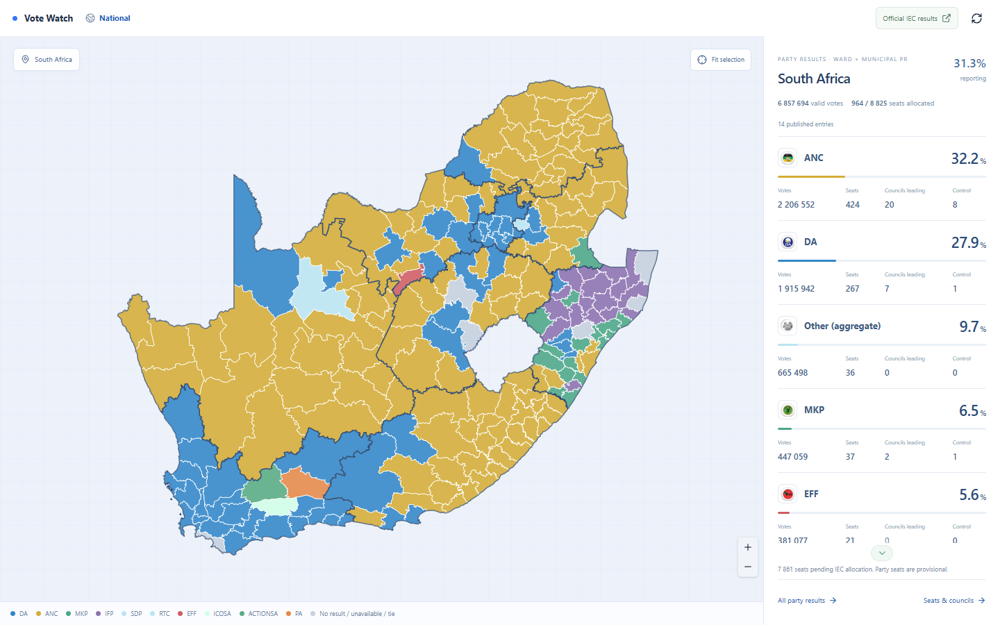
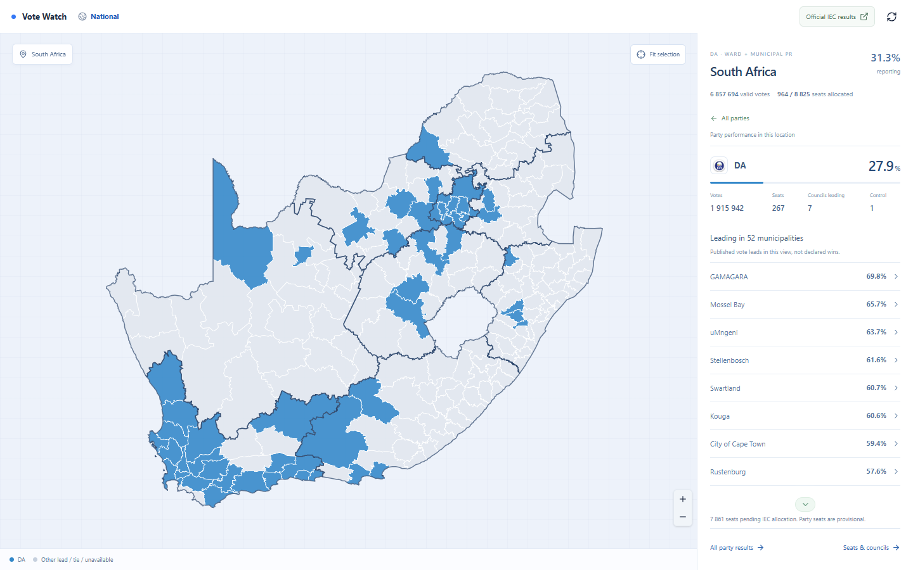
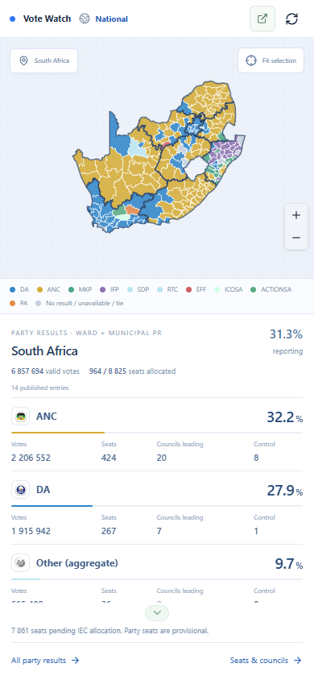
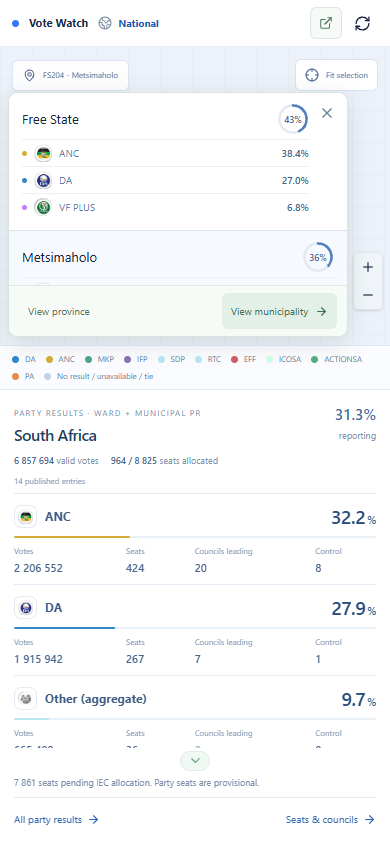

# Vote Watch

South African local election results on an interactive map. Explore provinces, municipalities, wards and voting districts, or select a party to see where it leads.

- Published IEC votes, party shares, seats and council counts.
- Background updates every 10 seconds, preserving the current map and scroll position.
- Party maps with location drill-down and shareable links.
- Desktop sidebar and mobile tap-to-explore results cards.

## Screenshots

### National results



### Party view



### Mobile




Screenshots show partial results captured on 5 November 2026.

## Run locally

Node.js 24+.

```sh
npm ci
npm run build
npm run server
```

Open http://127.0.0.1:3001. For development, also run `npm run dev` and open http://127.0.0.1:5173. No IEC credentials required.

```sh
npm test
```

Independent project. Results remain partial until officially declared. [Official IEC results](https://results.elections.org.za/dashboards/lge/) ? [Data and third-party credits](THIRD_PARTY_NOTICES.md).
